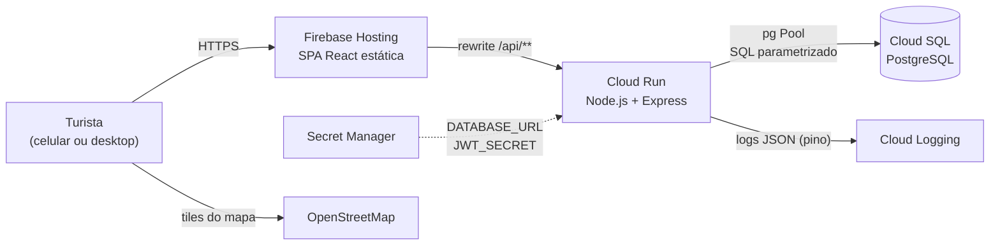
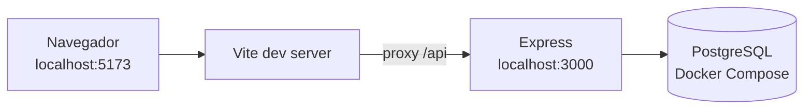
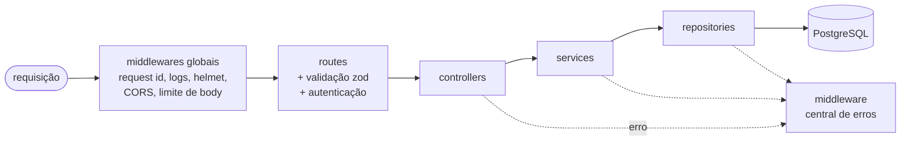
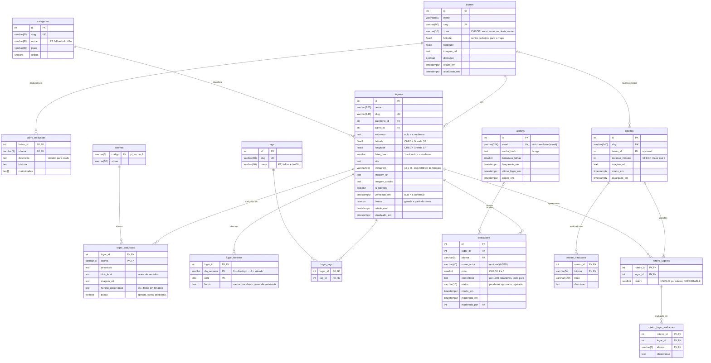

# Rolê SP — Arquitetura e decisões técnicas

> Fase 1 do projeto: plano de arquitetura, modelo de dados e decisões técnicas, cada uma com o seu porquê.
> Este documento é a base do README final. As decisões marcadas com **[validar]** mudam algo do briefing original e esperam aprovação.

> **Atualização (fase 2).** A especificação completa do projeto decidiu vários pontos marcados como **[validar]**. Valem estas decisões, e não as do plano original:
>
> - horário em `lugares.horario_funcionamento` (jsonb validado por CHECK), e não na tabela `lugar_horarios`;
> - observação das paradas em `roteiro_lugares.observacao` (`rotulo_i18n`, jsonb), e não na tabela `roteiro_lugar_traducoes`;
> - categorias `ponto-turistico`, `restaurante`, `bar`, `balada`, `sorveteria` e `padaria-cafe` (feiras entram como ponto turístico bairrista);
> - JSON da API em **camelCase**, com a conversão no repository, e não em snake_case;
> - backend em **CommonJS**, e não ESM;
> - PostgreSQL 16 na imagem Debian (collation ICU `pt_br`);
> - busca com as configurações `*_sem_acento` e a função `fn_tsquery_busca` (inclui prefixo e exclusão);
> - no ambiente local há um usuário de banco só; o papel separado, apenas com DML, para a API volta na fase 7 (Cloud SQL).
>
> O modelo de dados atual, com o diagrama ER, está em [`db/README.md`](../db/README.md). As seções 2, 3.4 e 8 abaixo ainda descrevem o plano original e serão revisadas no README final (fase 7).

## Sumário

1. [Visão geral](#1-visão-geral)
2. [Modelo de dados](#2-modelo-de-dados)
3. [API REST](#3-api-rest)
4. [Segurança](#4-segurança)
5. [Frontend](#5-frontend)
6. [Testes e CI](#6-testes-e-ci)
7. [Deploy](#7-deploy)
8. [Estrutura do repositório](#8-estrutura-do-repositório)
9. [Resumo das decisões](#9-resumo-das-decisões)
10. [Roadmap das fases](#10-roadmap-das-fases)

---

## 1. Visão geral

O Rolê SP é um guia de São Paulo para turistas. O diferencial é o selo **bairrista**: lugares que o paulistano frequenta e o turista não conhece, cada um com uma "dica de local" escrita como um morador falaria.

O projeto tem três peças:

| Peça | O que é | Por quê |
|---|---|---|
| `frontend/` | SPA em React (Vite), compilada para arquivos estáticos | Um site estático é barato de hospedar e fica em CDN, perto do usuário |
| `backend/` | API REST em Node.js + Express, sem estado (stateless) | Sem estado em memória, o Cloud Run pode criar e destruir instâncias à vontade |
| `db/` | PostgreSQL, com migrations e seeds em SQL puro | O SQL fica visível e versionado, e é o que o projeto quer demonstrar |

### 1.1 Produção



### 1.2 Ambiente local



### 1.3 Por que o front e a API ficam na mesma origem

O JWT do admin vai num cookie `httpOnly` com `SameSite=Strict`. Se o front estivesse em `rolesp.web.app` e a API em `*.run.app`, seriam **sites diferentes** e o navegador não mandaria o cookie. A saída seria `SameSite=None`, que reabre espaço para CSRF.

Com o *rewrite* do Firebase Hosting em produção e o *proxy* do Vite em desenvolvimento, o navegador só enxerga um domínio. Com isso:

- o cookie é *first-party* e funciona com `SameSite=Strict`;
- não há requisição cross-origin no fluxo normal. O CORS continua configurado com lista restrita, como defesa em profundidade e para o caso de outro front consumir a API.

Pegadinha documentada do Firebase: nas requisições repassadas ao Cloud Run, o Hosting **remove todos os cookies, menos um chamado `__session`**. Por isso o cookie de autenticação terá esse nome.

### 1.4 Camadas da API



| Camada | Responsabilidade | Não pode |
|---|---|---|
| **routes** | Ligar verbo + URL aos middlewares e ao controller | Ter lógica |
| **controllers** | Traduzir HTTP: ler a entrada já validada, chamar o service, escolher status e headers | Escrever SQL |
| **services** | Regras de negócio: fallback de idioma, avaliação nasce pendente, PT é obrigatório, transações | Conhecer `req` e `res` |
| **repositories** | Só SQL, sempre parametrizado. Recebem um *executor* (o pool ou o client de uma transação) | Conhecer regras de negócio |

**Por quê:** cada camada pode ser testada e trocada isoladamente. Se o Express virasse Fastify, só routes e controllers mudariam. Numa entrevista: "o controller não sabe que existe Postgres, e o repository não sabe que existe HTTP".

Exemplo de ponta a ponta, `GET /api/lugares?bairro=mooca&lang=en`:

1. A rota roda `validar(esquemaListagem, 'query')` e chama `lugaresController.listar`.
2. O controller lê `req.validado.query` e chama `lugaresService.listar(filtros)`.
3. O service aplica as regras (limite máximo, idioma com fallback) e chama `lugaresRepository.buscar(filtros)`.
4. O repository monta o SQL com placeholders `$1, $2…` e devolve as linhas.
5. O controller responde `200` com `{ dados, paginacao }`.

No Express 5, um erro lançado numa função `async` já vai direto para o middleware de erros, sem `try/catch` em cada controller.

---

## 2. Modelo de dados

### 2.1 Crítica do modelo inicial e melhorias

| # | Modelo inicial | Problema | Mudança |
|---|---|---|---|
| 1 | `bairros.descricao`, `bairros.curiosidade`, `roteiros.titulo/descricao` e `roteiro_lugares.observacao` em uma língua só | O site é bilíngue, mas só `lugares` tinha tradução | Criar `bairro_traducoes`, `roteiro_traducoes` e `roteiro_lugar_traducoes`, no mesmo padrão de `lugar_traducoes` |
| 2 | `idioma` como texto livre | `'PT'`, `'pt-BR'` e `'pt'` acabariam convivendo | Tabela `idiomas` (pt, en, de, fr) com FK. Adicionar um idioma vira um `INSERT`, não um `ALTER TABLE` |
| 3 | `horario_funcionamento JSONB` | O JSON não valida estrutura (`"seg": "das 9 às 18"` passaria). O extra "aberto agora" exigiria lógica em JS ou SQL ilegível sobre JSON | **[validar]** Tabela `lugar_horarios (dia_semana, abre, fecha)`, uma linha por turno. Se `fecha < abre`, o turno passa da meia-noite (balada das 23h às 5h). "Aberto agora" vira um `WHERE` simples. Exceções ("fecha em feriados") ficam em texto traduzível |
| 4 | `verificado boolean` | Não diz **quando** o lugar foi verificado. Num guia, informação envelhece | `verificado_em timestamptz`, com `NULL` = a confirmar. A API expõe `verificado: true/false` e a data |
| 5 | `faixa_preco` 1–4 | Se for obrigatório, força inventar preço | Continua 1–4, mas aceita nulo (`NULL` = a confirmar). "Gratuito" segue como tag |
| 6 | `endereco`, `latitude` e `longitude` obrigatórios | Mesmo problema: não queremos inventar dados | Aceitam nulo. Um `CHECK` garante que latitude e longitude venham juntas e dentro da Grande SP, o que pega o erro clássico de inverter as duas. Lugar sem coordenada aparece na lista, mas não no mapa |
| 7 | Nomes de `categorias` e `tags` só em PT | Precisam de tradução | São vocabulário de **interface** e só mudam junto com o código, então são traduzidas no i18next pelo slug, com o `nome` do banco como fallback. Conteúdo **editorial** (lugares, bairros, roteiros) muda pelo painel, então fica em tabelas de tradução |
| 8 | Imagem sem texto alternativo | Acessibilidade | `imagem_alt` em `lugar_traducoes`, porque o alt também precisa de tradução. `imagem_credito`, porque fotos do Wikimedia Commons exigem atribuição |
| 9 | `avaliacoes` sem rastro de moderação | Ninguém sabe quem aprovou nem quando | `moderado_por` (FK para `admins`) e `moderado_em`, com um `CHECK` de consistência: pendente ⇔ `moderado_em` nulo. Ganha também `idioma` |
| 10 | `avaliacoes.nome_autor` obrigatório | LGPD: minimizar dados pessoais | Opcional e curto (até 40 caracteres). Sem e-mail e sem IP no banco |
| 11 | `duracao_estimada` em formato indefinido | Texto livre não ordena nem filtra | `duracao_minutos integer CHECK (> 0)`. O tipo `interval` seria mais elegante, mas o `pg` devolve um objeto difícil de serializar |
| 12 | `roteiro_lugares` sem regra de ordem | Dois lugares poderiam ocupar a mesma posição | PK `(roteiro_id, lugar_id)` e `UNIQUE (roteiro_id, ordem) DEFERRABLE`, que permite trocar posições dentro de uma transação |
| 13 | `admins` sem defesa contra força bruta | O rate limit por IP não pega ataque distribuído | `tentativas_falhas` e `bloqueado_ate` (bloqueio por conta) e `ultimo_login_em`. E-mail único sem diferenciar maiúsculas, com índice único em `lower(email)` |
| 14 | Faltavam campos para a home e para o mapa | — | `bairros.destaque`, `bairros.latitude/longitude` (centro do bairro no mapa) e `categorias.ordem` |
| 15 | Seis categorias | Pastel de feira e pracinha com feira de artesanato não cabem em nenhuma | **[validar]** Nova categoria **Feiras e praças** |
| 16 | Tags de exemplo | — | Sugestão: tag **acessível** (cadeira de rodas), útil para o turista e coerente com o foco em acessibilidade |

### 2.2 Diagrama ER

Todas as tabelas `*_traducoes` e a coluna `avaliacoes.idioma` referenciam `idiomas(codigo)`. No diagrama aparece só uma dessas ligações, para não poluir.



São 15 tabelas, mais a `schema_migrations`, que é interna do runner de migrations.

### 2.3 Convenções

- **PKs `integer GENERATED ALWAYS AS IDENTITY`**: é o padrão SQL e substitui o `serial`. As URLs públicas usam **slug**, que é legível, bom para SEO e não expõe a sequência de ids. O painel admin usa **id**, porque o slug pode mudar numa edição.
- **Slugs** têm `CHECK (slug ~ '^[a-z0-9]+(-[a-z0-9]+)*$')`.
- **Domínios fechados** (zona, status, nota, faixa de preço) usam `CHECK`, não `ENUM` do Postgres. Mudar um `CHECK` é uma migration trivial; tirar um valor de um `ENUM` não é.
- **Datas** são sempre `timestamptz`. Uma trigger, `fn_atualizar_timestamp()`, preenche `atualizado_em`.
- **Coordenadas** são `double precision`. O `pg` devolve `numeric` como **string**, para não perder precisão; `double precision` chega como `number` no JS e é o tipo que as fórmulas de distância usam.
- **Comportamento das FKs**: `ON DELETE CASCADE` onde o filho não existe sem o pai (traduções, horários, tags do lugar, avaliações). `RESTRICT` onde apagar causaria perda silenciosa (lugar que está num roteiro, categoria ou bairro com lugares). A API transforma o `RESTRICT` em **409 Conflict** com mensagem clara.

### 2.4 Índices

| Índice | Para quê |
|---|---|
| `lugares (categoria_id)` e `lugares (bairro_id)` | Filtros e JOINs. O Postgres **não** cria índice em FK sozinho, só em PK e UNIQUE |
| GIN em `lugares (busca)` e em `lugar_traducoes (busca)` | Busca textual |
| `lugar_tags (tag_id, lugar_id)` | Filtro por tag. A PK `(lugar_id, tag_id)` só ajuda na busca pelo lado do lugar |
| `avaliacoes (lugar_id, criado_em DESC) WHERE status = 'aprovada'` | **Índice parcial**: a view e a página do lugar só leem avaliações aprovadas |
| `avaliacoes (criado_em) WHERE status = 'pendente'` | Fila de moderação do painel |
| `roteiro_lugares (lugar_id)` | O `RESTRICT` no `DELETE` de um lugar precisa procurar por `lugar_id` |
| PK `lugar_horarios (lugar_id, dia_semana, abre)` | "Aberto agora". Não precisa de índice extra: um índice composto também serve para buscas pelo começo dele (`lugar_id, dia_semana`) |
| `UNIQUE` em slugs e em `lower(email)` | Integridade e busca direta |

**O que não indexar:** `is_bairrista` e `faixa_preco` têm pouquíssimos valores distintos, e o planner quase nunca escolheria esse índice. Com algumas centenas de linhas, o Postgres vai preferir *seq scan* em quase tudo: os índices são para crescimento. O README vai mostrar um `EXPLAIN ANALYZE` com e sem índice.

### 2.5 View `vw_lugares_resumo`

Rascunho (a versão final sai na fase 2):

```sql
CREATE VIEW vw_lugares_resumo AS
SELECT
  l.id, l.slug, l.nome, l.faixa_preco, l.is_bairrista,
  l.verificado_em IS NOT NULL            AS verificado,
  l.latitude, l.longitude, l.imagem_url,
  c.slug AS categoria_slug, c.nome AS categoria_nome,
  b.slug AS bairro_slug,    b.nome AS bairro_nome,
  ROUND(AVG(a.nota), 1)::float8          AS media_notas,      -- NULL se não houver avaliação
  COUNT(a.id)::int                       AS total_avaliacoes
FROM lugares l
JOIN categorias c ON c.id = l.categoria_id
JOIN bairros    b ON b.id = l.bairro_id
LEFT JOIN avaliacoes a
       ON a.lugar_id = l.id
      AND a.status = 'aprovada'   -- no ON, não no WHERE
GROUP BY l.id, c.id, b.id;
```

Pontos para defender:

- **O filtro de status fica no `ON`.** No `WHERE`, ele transformaria o `LEFT JOIN` num `INNER JOIN` na prática, e lugares sem avaliação sumiriam da lista.
- **A média é `NULL` quando não há avaliação**, não 0. Mostrar "0 estrelas" seria mentir.
- **`GROUP BY l.id` basta** para as colunas de `lugares`, porque o Postgres reconhece a dependência funcional da PK.
- **A view não tem tradução:** ela não depende de idioma. O repository faz o JOIN com `lugar_traducoes` conforme o `lang`.
- **Trade-off:** a view agrega a cada consulta. Se o volume crescer, o caminho é uma *materialized view* com `REFRESH` ou contadores mantidos por trigger.

### 2.6 Transações

Criar ou editar um roteiro grava em quatro tabelas: `roteiros`, `roteiro_traducoes`, `roteiro_lugares` e `roteiro_lugar_traducoes`. É tudo ou nada: se um `lugar_id` não existir, a FK falha e **nada** fica gravado. Criar ou editar um lugar segue o mesmo padrão (lugar, traduções, tags e horários).

```js
// backend/src/db/transacao.js — rascunho
export async function comTransacao(pool, funcao) {
  const client = await pool.connect();
  try {
    await client.query('BEGIN');
    const resultado = await funcao(client); // repositories recebem este client
    await client.query('COMMIT');
    return resultado;
  } catch (erro) {
    await client.query('ROLLBACK');
    throw erro; // o middleware de erros decide o status HTTP
  } finally {
    client.release(); // devolve a conexão ao pool mesmo em caso de erro
  }
}
```

- **Por que o repository recebe o executor:** a mesma função funciona com o `pool` (fora de transação) e com o `client` (dentro dela), sem duplicar SQL.
- **Edição de roteiro:** `UPDATE` no roteiro, `DELETE` das paradas antigas e `INSERT` das novas em lote com `unnest($1::int[], $2::int[])`. É uma query só e continua parametrizada.
- **Teste garantido:** criar um roteiro com um lugar inexistente devolve 422, e o banco fica intacto.

### 2.7 Busca textual (tsvector + unaccent)

- Extensão `unaccent` e três configurações de busca:
  - `busca_pt`: `unaccent` seguido de `portuguese_stem`;
  - `busca_en`: o equivalente em inglês;
  - `busca_simples`: sem stemming, para nomes próprios.
- `lugares.busca` é uma **coluna gerada** (`GENERATED ALWAYS AS (...) STORED`) a partir do nome. Não precisa de trigger.
- `lugar_traducoes.busca` é gerada a partir da descrição (peso A) e da dica (peso B), com a configuração do idioma de cada linha. DE e FR só precisam de uma configuração nova.
- A consulta usa `websearch_to_tsquery`, que aceita `"frase exata"`, `-exclusão` e `or` sem dar erro de sintaxe com qualquer texto que o usuário digite, e ordena por `ts_rank`.

Testado num Postgres 16 durante o planejamento:

| Busca | Acha | Por quê |
|---|---|---|
| `pasteis` | "Pastéis enormes…" | `unaccent` e stemming |
| `pacaembú` | o nome "Pastelaria da Feira do Pacaembu" | `unaccent` no nome |
| `pastry` | o texto em inglês | configuração por idioma |
| `pastel` | **não** acha "pastéis" | **limitação conhecida**: o stemmer Snowball não une plurais irregulares (`pastel` vira 'pastel'; `pastéis` vira 'past') |

O complemento futuro é o `pg_trgm` (similaridade por trigramas), que também resolve erros de digitação.

### 2.8 Filtros combinados e paginação

- **Query builder** pequeno: uma lista de condições e uma lista de valores, e cada valor vira um `$n`. Nada que vem do usuário é concatenado. As partes dinâmicas, como o `ORDER BY`, saem de uma lista fixa (whitelist).
- **Tags com semântica "E"**, ou seja, o lugar precisa ter todas: `GROUP BY lugar_id HAVING count(*) = <número de tags>`. É uma "divisão relacional", um bom exemplo para entrevista.
- **Preço aceita lista**: `faixa_preco = ANY($n::int[])`.
- **Total sem segunda query**: `count(*) OVER ()` traz a página e o total juntos.
- **Paginação por `OFFSET`**: é simples e permite "ir para a página 3". O limite máximo é 50. Para volume grande, o caminho seria *keyset pagination*.

### 2.9 Dica bairrista do dia

```sql
ORDER BY md5(l.id::text || (now() AT TIME ZONE 'America/Sao_Paulo')::date::text)
LIMIT 1
```

É um sorteio **determinístico**: muda à meia-noite no horário de SP e é igual para todo mundo durante o dia. Não precisa de cron nem de tabela extra, e a resposta pode ficar em cache até o fim do dia.

### 2.10 Migrations, seeds e menor privilégio

- **Arquivos numerados** em `db/migrations/`: `001_extensoes_e_busca.sql`, `002_tabelas.sql`, `003_indices.sql`, `004_views.sql` etc.
- **Runner próprio** (`npm run db:migrar`, cerca de 60 linhas): aplica os arquivos em ordem, cada um dentro de uma transação, e registra o que rodou em `schema_migrations`. Funciona igual no local, no CI e no Cloud Run (como Job).
  - Uma lib como o `node-pg-migrate` resolveria, mas esconderia justamente o que quero mostrar.
  - O `docker-entrypoint-initdb.d` do Postgres só roda na primeira inicialização e não serve para o Cloud SQL.
- **Migrations só vão para frente.** Em produção, um erro se corrige com uma migration nova.
- **Seeds** em `db/seeds/` são idempotentes (`ON CONFLICT (slug) DO NOTHING`) e referenciam por slug (`(SELECT id FROM bairros WHERE slug = 'mooca')`), nunca por id fixo.
- **Política do seed:**
  - Todo registro nasce com `verificado_em = NULL`, **inclusive os pontos turísticos**. Você confere e marca pelo painel.
  - Pontos turísticos: dados públicos e estáveis (nome, bairro, coordenadas, descrição), sem horários nem preços.
  - Restaurantes, bares, baladas e sorveterias: poucos exemplos, sem endereço, horário ou preço. O front mostra "informação a confirmar".
- **Menor privilégio no banco:** dois papéis.
  - `rolesp_owner` roda as migrations (DDL).
  - `rolesp_app`, usado pela API, só tem `SELECT`, `INSERT`, `UPDATE` e `DELETE`. Se uma injeção escapasse, não conseguiria fazer `DROP`, `ALTER` nem criar funções.
  - O pool da API também define `statement_timeout`, para que uma query lenta não prenda conexões.

---

## 3. API REST

Base: `/api`. As chaves do JSON ficam em português e em `snake_case`, iguais às colunas do banco. **[validar]**

**Por quê:** o `pg` já devolve as linhas em `snake_case`, então não é preciso uma camada de conversão, que costuma ser fonte de bug. APIs conhecidas, como as do GitHub e do Stripe, também usam `snake_case`. No código JS, as variáveis continuam em `camelCase`.

### 3.1 Rotas públicas

| Método e rota | Descrição | Sucesso |
|---|---|---|
| `GET /api/lugares` | Lista com filtros: `categoria`, `bairro`, `preco` (ex.: `1,2`), `tags` (ex.: `vegano,pet-friendly`), `bairrista`, `q`, `lang`, `ordem`, `page`, `limit` | 200 |
| `GET /api/lugares/:slug` | Detalhe: tradução, tags, horários, média e total de avaliações | 200 / 404 |
| `GET /api/lugares/:slug/avaliacoes` | Avaliações aprovadas, paginadas *(nova)* | 200 |
| `POST /api/lugares/:slug/avaliacoes` | Cria avaliação com `status = pendente` (rate limit) | 201 |
| `GET /api/bairros` e `GET /api/bairros/:slug` | Os lugares do bairro vêm de `GET /api/lugares?bairro=` (reuso) | 200 / 404 |
| `GET /api/categorias` e `GET /api/tags` | Listas para filtros e atalhos | 200 |
| `GET /api/roteiros` e `GET /api/roteiros/:slug` | Detalhe com as paradas em ordem | 200 / 404 |
| `GET /api/dica-do-dia` | Dica bairrista do dia *(nova)* | 200 |
| `GET /api/saude` | Health check para o Cloud Run *(nova)* | 200 |

### 3.2 Autenticação

| Método e rota | Descrição |
|---|---|
| `POST /api/auth/login` | Verifica com bcrypt e grava o cookie `__session` (JWT). Tem rate limit e bloqueio por conta |
| `POST /api/auth/logout` | Apaga o cookie *(nova)* |
| `GET /api/auth/me` | Diz ao front se há sessão ativa *(nova)* |

### 3.3 Rotas de admin (exigem JWT válido)

| Rota | Verbos |
|---|---|
| `/api/admin/lugares` e `/api/admin/lugares/:id` | `GET`, `POST`, `GET :id`, `PUT :id`, `DELETE :id` |
| `/api/admin/bairros` e `/api/admin/bairros/:id` | idem |
| `/api/admin/roteiros` e `/api/admin/roteiros/:id` | idem, com transação |
| `/api/admin/avaliacoes?status=pendente` | `GET` (fila de moderação) |
| `/api/admin/avaliacoes/:id` | `PATCH { "status": "aprovada" \| "rejeitada" }` |

O `PUT` substitui o recurso inteiro (traduções, tags e horários) dentro de uma transação. CRUD de categorias e tags fica fora do MVP: elas vêm do seed.

### 3.4 Formato das respostas

Lista:

```json
{
  "dados": [
    {
      "slug": "exemplo-pastel-de-feira",
      "nome": "…",
      "categoria": { "slug": "feiras-e-pracas", "nome": "Feiras e praças" },
      "bairro": { "slug": "mooca", "nome": "Mooca" },
      "faixa_preco": null,
      "is_bairrista": true,
      "verificado": false,
      "media_notas": 4.7,
      "total_avaliacoes": 12,
      "descricao": "…",
      "idioma_conteudo": "pt"
    }
  ],
  "paginacao": { "pagina": 1, "limite": 20, "total": 57, "total_paginas": 3 }
}
```

O campo `idioma_conteudo` existe por causa do fallback: se o usuário pede `lang=en` e o lugar ainda não tem tradução em inglês, a API devolve o texto em PT e avisa. O front então mostra "disponível só em português".

Erro, sempre no mesmo formato, montado pelo middleware central:

```json
{
  "erro": {
    "codigo": "VALIDACAO",
    "mensagem": "Parâmetros inválidos.",
    "detalhes": [{ "campo": "preco", "mensagem": "Use valores de 1 a 4." }],
    "request_id": "7f3c…"
  }
}
```

O `codigo` é estável e legível por máquina, e o front traduz a mensagem a partir dele. O `request_id` é o mesmo do log: o usuário informa o id e quem investiga acha a requisição no log na hora. É o mesmo raciocínio de correlação de eventos num SIEM.

### 3.5 Status HTTP

| Status | Quando |
|---|---|
| 200 | Leitura ou atualização com corpo |
| 201 | Criação (no admin, com header `Location`) |
| 204 | `DELETE` bem-sucedido |
| 400 | Entrada inválida (zod) |
| 401 | Sem sessão ou com sessão expirada |
| 404 | Slug ou id inexistente |
| 409 | Slug duplicado (`23505`) ou exclusão bloqueada por FK `RESTRICT` (`23503` no `DELETE`) |
| 422 | Referência inexistente no corpo, como um `lugar_id` que não existe num roteiro (`23503` no `INSERT`) |
| 429 | Rate limit, com header `Retry-After` |
| 500 | Erro inesperado: mensagem genérica, sem stack nem SQL em produção |

O middleware de erros traduz os códigos do Postgres (`23505`, `23503`, `23514`) para status HTTP. Assim os repositories não precisam conhecer HTTP.

### 3.6 Validação

**zod** em vez de express-validator: o esquema é um objeto JS reaproveitável, faz conversão de tipos (a query string só tem texto: `"2"` vira `2` e `"true"` vira `true`) e funciona fora do Express, em services e testes.

Os esquemas de corpo usam `.strict()`, que **rejeita campos extras**. Assim um visitante não consegue mandar `"status": "aprovada"` no POST de avaliação e aprovar a própria avaliação (*mass assignment*).

No Express 5, `req.query` é somente leitura, então o resultado validado fica em `req.validado`.

---

## 4. Segurança

### 4.1 Ameaças e controles

| Ameaça | Controle | Onde |
|---|---|---|
| SQL injection | Queries sempre parametrizadas; `ORDER BY` por whitelist; testes com payloads como `' OR 1=1 --` no `q` | repositories |
| Estrago de uma injeção que escapasse | Papel `rolesp_app` sem DDL e `statement_timeout` | banco |
| XSS armazenado (comentários) | Limite de tamanho; HTML removido na entrada (`sanitize-html` sem nenhuma tag permitida); React escapa na saída; proibido `dangerouslySetInnerHTML`; CSP no Hosting | service e front |
| Roubo de sessão via XSS | JWT em cookie `httpOnly` (o JS não lê), `Secure`, `SameSite=Strict`, expiração curta (2h) | auth |
| CSRF | `SameSite=Strict`, mesma origem, CORS com lista restrita e mutações só aceitam `application/json` | app |
| Força bruta e *credential stuffing* no login | Rate limit por IP (5 a cada 15 min); bloqueio por conta após 5 falhas; bcrypt com custo 12 | auth |
| Enumeração de e-mails de admin | Mesma mensagem para e-mail e senha errados; bcrypt roda contra um hash falso quando o e-mail não existe, para igualar o tempo de resposta | auth |
| Spam de avaliações | Rate limit (5 por hora por IP), campo *honeypot* invisível e moderação: nada é publicado sem aprovação | avaliações |
| Mass assignment | `.strict()` no zod; o `status` é definido só pelo servidor | validação |
| Vazamento de informação | Handler de erro sem stack nem SQL em produção; `helmet` remove `X-Powered-By`; logs com *redact* de cookie, senha e authorization | app |
| Segredos expostos | Só no `.env` (ignorado pelo git) e `.env.example` no repositório; variáveis validadas com zod na inicialização (por exemplo, `JWT_SECRET` com pelo menos 32 caracteres); Secret Manager em produção | config |
| Dependências vulneráveis | `npm audit --audit-level=high` no CI e Dependabot | CI |
| Abuso e DoS simples | Limite de body (`10kb`), `limit` máximo 50, `statement_timeout` | app e banco |
| Acesso ao painel | Rotas `/admin` do front são só conveniência. **Quem protege é a API** (middleware de auth em `/api/admin/*`) | API |
| Admin criado por terceiros | Não existe rota de cadastro: admin só é criado por script de linha de comando (`npm run admin:criar`) | backend |

**Rate limit e múltiplas instâncias:** o `express-rate-limit` guarda os contadores em memória, então cada instância do Cloud Run conta separado. Para este projeto, `max-instances` baixo resolve. Num sistema maior, o store seria Redis ou o próprio Postgres. O bloqueio por conta fica no banco e já é global. Atrás do proxy do Google, é preciso configurar `app.set('trust proxy', …)`, senão todo mundo aparece com o mesmo IP.

### 4.2 Logs estruturados

O **pino** com `pino-http` gera uma linha JSON por requisição, com `request_id`. O id vem do header `X-Request-Id`, se for válido, ou é gerado com `crypto.randomUUID()`, e volta no header da resposta.

Eventos de segurança com nome fixo, para virar alerta:

| Evento | Quando |
|---|---|
| `auth.login_sucesso` | Login aceito |
| `auth.login_falhou` | E-mail ou senha errados (registra o e-mail tentado, IP e user-agent) |
| `auth.conta_bloqueada` | Conta atingiu o limite de falhas |
| `rate_limit.excedido` | Alguém bateu no rate limit |
| `avaliacao.criada` | Nova avaliação pendente |
| `avaliacao.moderada` | Avaliação aprovada ou rejeitada (com o admin) |
| `admin.recurso_alterado` | Criação, edição ou exclusão no painel (com o admin) |

```json
{"level":"warn","severity":"WARNING","time":"2026-10-11T21:04:12.310Z","request_id":"7f3c…","evento":"auth.login_falhou","email":"admin@exemplo.com","ip":"203.0.113.7","user_agent":"curl/8.5","tentativas_falhas":3}
```

O campo `severity` é o que o Cloud Logging lê para classificar o nível. Na fase 7, a ideia é criar uma métrica baseada em log e um alerta para "mais de 10 `auth.login_falhou` em 5 minutos": na prática, uma regra de SIEM.

### 4.3 LGPD

- A avaliação guarda só apelido (opcional), nota, comentário e idioma. Não guarda e-mail nem IP.
- O formulário avisa "não escreva dados pessoais".
- O IP aparece só nos logs, com finalidade de segurança (legítimo interesse) e retenção limitada.
- As fontes são servidas pelo próprio site (pacotes `@fontsource`), não pela CDN do Google Fonts, que receberia o IP de cada visitante.
- Haverá uma página curta de privacidade explicando isso.

---

## 5. Frontend

Na fase 5, cada conceito de React (componentes, props, estado, hooks, rotas) será explicado na primeira vez que aparecer no código. Aqui fica só o desenho.

### 5.1 Rotas

| Rota | Página |
|---|---|
| `/` | Home: busca, atalhos por categoria, bairros em destaque, dica do dia |
| `/explorar` | Lista e mapa com filtros |
| `/lugar/:slug` | Detalhe do lugar |
| `/bairro/:slug` | Página do bairro |
| `/roteiros` e `/roteiros/:slug` | Roteiros |
| `/admin` | Login e, depois dele, painel com subrotas (`/admin/lugares`, `/admin/avaliacoes`…) |
| `*` | Página 404 |

O painel é carregado sob demanda (*lazy loading*), para que o turista não baixe o código do admin.

### 5.2 Decisões

- **O estado dos filtros vive na URL** (`/explorar?categoria=bares-e-botecos&bairrista=true`). O link pode ser compartilhado, o botão "voltar" funciona e um F5 não perde nada.
- **Dados com `fetch` puro** em `services/api.js`, com um hook próprio (`useApi`) que cuida de carregando, erro e dados e cancela requisições antigas com `AbortController`. Uma lib como React Query seria a escolha em produção, mas aqui o objetivo é entender o mecanismo antes de abstrair.
- **Lista e mapa mostram o mesmo conjunto**, a página atual. Passar o mouse num card destaca o pino e vice-versa.
- **Idioma:** é detectado no navegador e lembrado no `localStorage`, vai para a API como `?lang=` e atualiza o `<html lang>`, para o leitor de tela pronunciar certo. A URL não tem prefixo de idioma (`/en/...`), o que é mais simples; o custo é um pouco de SEO.

### 5.3 Componentes reutilizáveis

- **Pedidos no briefing:** `CardLugar`, `Filtros`, `Mapa` (também usado como mini mapa), `SeloBairrista` e `SeletorIdioma`.
- **Estrutura e estados:** `Layout` (cabeçalho e rodapé), `EstadoCarregando`, `EstadoErro`, `EstadoVazio` e `Paginacao`.
- **Lugar e avaliações:** `AvisoAConfirmar` ("informação a confirmar"), `NotaEstrelas`, `ListaAvaliacoes` e `FormAvaliacao`.

### 5.4 Estilo

- **CSS Modules** por componente e um `styles/variaveis.css` com os *design tokens*: cores, espaçamentos, fontes e raios.
- **Mobile first:** o CSS base é para celular e `@media (min-width: …)` adapta para telas maiores. No Explorar, o celular tem abas Lista/Mapa; a partir de 1024px, um Grid de duas colunas.
- **Identidade visual:** cinza concreto como base, cores de arte de rua (amarelo, magenta, verde e azul) como destaque e tipografia condensada e forte nos títulos, lembrando cartaz e lambe-lambe. As cores vibrantes vão como fundo com texto escuro, porque texto vibrante sobre branco costuma reprovar no contraste mínimo.
- **Mapa:**
  - Leaflet com tiles do OpenStreetMap, com a atribuição obrigatória e uso leve, como pede a política de uso dos tiles.
  - Pinos customizados por categoria (`DivIcon`), o que também evita o bug clássico do ícone padrão do Leaflet sumir com bundlers.

### 5.5 Acessibilidade

- Contraste mínimo **AA** verificado na paleta.
- `alt` vindo do banco e traduzido.
- `label` em todo campo.
- Foco visível.
- Link "pular para o conteúdo".
- Navegação completa por teclado.
- O mapa é complementar: **todo dado do mapa também está na lista**, que é a alternativa acessível.

---

## 6. Testes e CI

- **Testes de integração com Jest + Supertest contra um Postgres real** (banco `rolesp_test`):
  - as migrations rodam antes da suíte;
  - cada arquivo de teste limpa as tabelas (`TRUNCATE … RESTART IDENTITY CASCADE`) e insere suas fixtures;
  - os arquivos rodam em série (`--runInBand`), porque compartilham o mesmo banco;
  - **por quê:** o coração do projeto é SQL, e mockar o banco testaria quase nada.
- **Testes unitários** para funções puras: query builder, slug, sanitização e lógica de horário.
- **Casos obrigatórios:**
  - filtros combinados e paginação;
  - 404 e 400;
  - SQL injection no `q` devolvendo resposta normal;
  - POST de avaliação com campo `status` sendo rejeitado;
  - payload de XSS sendo limpo;
  - 429 no rate limit;
  - 401 sem cookie;
  - **rollback da transação** de roteiro com um lugar inválido.
- **GitHub Actions** em todo push:
  - serviço Postgres;
  - `npm ci`;
  - lint (ESLint e Prettier);
  - testes com cobertura;
  - `npm audit --audit-level=high`;
  - build do front.
- **ESM (`import`/`export`) no backend**, a mesma sintaxe do front. O custo é o Jest precisar da flag `--experimental-vm-modules`. Para isolar dependências nos testes unitários, os services recebem os repositories como parâmetro (injeção de dependência) em vez de usar `jest.mock`.

---

## 7. Deploy

### 7.1 Google Cloud

| Peça | Serviço | Notas |
|---|---|---|
| API | **Cloud Run** | Imagem Docker multi-stage, roda como usuário não-root, `npm ci --omit=dev`. `min-instances=0`: escala a zero e custa perto de nada parado; o preço é o *cold start* |
| Banco | **Cloud SQL (PostgreSQL)** | Conexão pelo conector nativo do Cloud Run (socket Unix, sem IP público). Instância *shared-core*: não tem free tier, custa a partir de uns US$ 10 por mês (conferir na calculadora na fase 7) |
| Front | **Firebase Hosting** | CDN e HTTPS com cota gratuita. Por causa do Cloud Run, o projeto fica no plano Blaze, que mantém as cotas grátis. *Rewrite* `/api/**` para o serviço do Cloud Run |
| Segredos | **Secret Manager** | `DATABASE_URL` e `JWT_SECRET` injetados como variáveis de ambiente |
| Migrations | **Cloud Run Job** | Mesma imagem, comando `npm run db:migrar`, roda antes de cada deploy |
| Observabilidade | **Cloud Logging** | Logs JSON do pino já chegam estruturados |

**Região:** `southamerica-east1` (São Paulo) tem a menor latência para quem está em SP, mas é mais cara que `us-central1`. A escolha final fica para a fase 7, com os números na mão.

Antes de qualquer deploy, vamos configurar um **alerta de orçamento** no Google Cloud.

### 7.2 Alternativa gratuita

Trocar **só o banco**: Cloud SQL sai e entra o **Neon** (Postgres serverless com plano gratuito, que escala a zero). O Cloud Run e o Firebase Hosting seguem iguais, com free tier.

**Por quê:** muda apenas a `DATABASE_URL` (com SSL), e a arquitetura do currículo continua "Cloud Run + Firebase". Os limites do plano gratuito (armazenamento e horas de compute) serão conferidos na fase 7, porque mudam com frequência.

Uma alternativa ainda mais simples, tudo no Render, foi descartada como principal: o Postgres gratuito de lá expira.

---

## 8. Estrutura do repositório

```text
rolesp/
├── backend/
│   ├── src/
│   │   ├── config/          # leitura e validação das variáveis de ambiente (zod)
│   │   ├── db/              # pool, comTransacao, runner de migrations
│   │   ├── routes/
│   │   ├── controllers/
│   │   ├── services/
│   │   ├── repositories/
│   │   ├── middlewares/     # validar, autenticar, erros, rate limit, request id
│   │   ├── schemas/         # esquemas zod
│   │   ├── utils/           # query builder, slug, erros da aplicação
│   │   ├── app.js           # monta o Express (sem listen: o Supertest usa direto)
│   │   └── server.js        # sobe o servidor
│   ├── scripts/             # criar-admin.js
│   ├── tests/
│   │   ├── integracao/
│   │   ├── unitarios/
│   │   └── helpers/
│   ├── Dockerfile
│   ├── .env.example
│   └── package.json
├── frontend/
│   ├── src/
│   │   ├── pages/
│   │   ├── components/
│   │   ├── hooks/
│   │   ├── services/api.js
│   │   ├── i18n/            # locales/pt.json, en.json, de.json, fr.json
│   │   └── styles/
│   ├── .env.example
│   └── package.json
├── db/
│   ├── migrations/          # 001_….sql, 002_….sql …
│   └── seeds/
├── docs/                    # este documento, diagramas, prints
├── .github/workflows/ci.yml
├── docker-compose.yml
├── .env.example             # credenciais do Postgres local
└── README.md
```

**`app.js` separado de `server.js`:** o Supertest importa o `app` e faz requisições sem abrir porta. Isso deixa os testes rápidos e sem conflito de porta.

---

## 9. Resumo das decisões

| Decisão | Por quê | Alternativa descartada |
|---|---|---|
| Express **5** | Erros async vão sozinhos para o handler; é a versão estável atual | Express 4 com `express-async-errors` |
| **ESM** no backend | Padrão da linguagem e mesma sintaxe do front | CommonJS (mais simples no Jest, mas legado) |
| `pg` com **SQL à mão** | Controle total, SQL visível para revisar e defender | ORM (Prisma, Sequelize) |
| **Repository recebe o executor** | A mesma função roda dentro e fora de transação | Repository que sempre usa o pool global |
| **zod** | Esquemas reaproveitáveis, conversão de tipos, `.strict()` contra mass assignment | express-validator |
| **Tabelas de tradução** e tabela `idiomas` | Novo idioma é um `INSERT`; fallback com `LEFT JOIN` | Colunas `descricao_pt`/`descricao_en`, ou JSONB por idioma |
| Categorias e tags traduzidas no **i18next** | São vocabulário de interface, mudam com o código | Tabelas de tradução para tudo |
| `lugar_horarios` em tabela | Validável, e o "aberto agora" vira SQL simples | JSONB |
| `verificado_em` | Num guia, informação tem data de validade | `verificado boolean` |
| `CHECK` em vez de `ENUM` | Fácil de alterar com migration | `CREATE TYPE … AS ENUM` |
| Colunas `tsvector` **geradas** | Sem trigger, sempre consistentes, indexadas com GIN | Trigger, ou `ILIKE '%…%'` |
| `count(*) OVER ()` | Página e total numa query só | Duas queries |
| Paginação por **OFFSET** | Simples e permite pular de página; o volume é pequeno | Keyset |
| **Runner próprio** de migrations | Mostra o mecanismo; roda igual em todo ambiente | node-pg-migrate, `initdb.d` |
| **Dois papéis** no banco | Menor privilégio | Um superusuário para tudo |
| JWT em cookie **`__session`** `httpOnly`, `SameSite=Strict` | Inacessível ao JS; nome exigido pelo Firebase Hosting | Token no `localStorage` (vulnerável a XSS) |
| **Mesma origem** (rewrite e proxy) | Cookie first-party, sem CORS no fluxo normal | Front e API em domínios separados |
| **pino** com `request_id` | JSON nativo para o Cloud Logging, rápido, correlação de eventos | morgan, `console.log` |
| Testes contra **Postgres real** | O valor do projeto está no SQL | Mock do `pg` |
| **`fetch` com hook próprio** no front | Aprender o mecanismo | React Query |
| Filtros **na URL** | Compartilhável, "voltar" funciona | Estado só em memória |
| **CSS Modules** com variáveis | Escopo por componente sem colisão de nomes, sem framework | CSS global, Tailwind |
| Fontes **self-hosted** | Desempenho e LGPD | Google Fonts CDN |
| Cloud Run + Firebase + **Neon** (alternativa) | Troca uma variável e mantém a arquitetura | Render |

**Versões-alvo:**

| Peça | Versão |
|---|---|
| Node.js | LTS ≥ 22 |
| PostgreSQL | 17 (no Docker e no Cloud SQL) |
| React | 19 |
| React Router | 7 |
| react-leaflet | 5 |
| Jest | 30 |
| zod | 4 |

---

## 10. Roadmap das fases

| Fase | Entrega | Commits esperados (Conventional Commits) |
|---|---|---|
| 1 | Este documento | `docs: adiciona plano de arquitetura e modelo de dados` |
| 2 | `docker-compose.yml`, papéis do banco, migrations, view, índices, seed e runner | `chore: docker compose com postgres`, `feat(db): migrations iniciais`, `feat(db): view vw_lugares_resumo`, `feat(db): seed de bairros e pontos turisticos` |
| 3 | API pública, query builder, busca, testes e CI | `feat(api): …`, `test(api): …`, `ci: …` |
| 4 | Login, admin, rate limit, helmet, CORS, logs de segurança | `feat(auth): …`, `feat(admin): …`, `feat(seguranca): …` |
| 5 | Layout, home, explorar com mapa, detalhes | `feat(front): …` |
| 6 | i18n PT/EN (estrutura DE/FR), acessibilidade, polimento | `feat(i18n): …`, `fix(a11y): …`, `style: …` |
| 7 | README com prints e diagramas, Dockerfile, deploy | `docs: …`, `build: …`, `ci: deploy …` |
